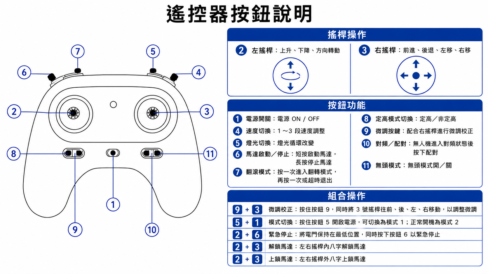
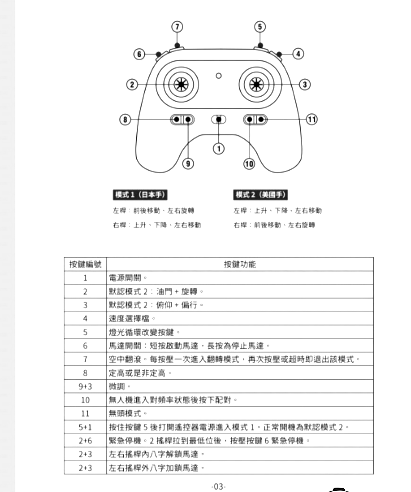

# Feeby 操作手冊

## 遙控器按鈕說明

### 搖桿操作
| 編號 | 名稱 | 功能 |
|---|---|---|
| 2 | 左搖桿 | 上升、下降、方向轉動 |
| 3 | 右搖桿 | 前進、後退、左移、右移 |

### 按鈕功能
| 編號 | 名稱 | 功能 |
|---|---|---|
| 1 | 電源開關 | 電源 ON / OFF |
| 4 | 速度切換 | 1～3 段速度調整 |
| 5 | 燈光切換 | 燈光循環改變 |
| 6 | 馬達啟動／停止 | 短按啟動馬達，長按停止馬達 |
| 7 | 翻滾模式 | 按一次進入翻轉模式，再按一次或超時退出 |
| 8 | 定高模式切換 | 定高／非定高 |
| 9 | 微調按鍵 | 配合右搖桿進行微調校正 |
| 10 | 對頻／配對 | 無人機進入對頻狀態後按下配對 |
| 11 | 無頭模式 | 無頭模式開／關 |

### 組合操作
| 組合 | 名稱 | 說明 |
|---|---|---|
| 9 + 3 | 微調校正 | 按住按鈕 9，同時將 3 號搖桿往前、後、左、右移動，以調整微調 |
| 5 + 1 | 模式切換 | 按住按鈕 5 開啟電源，可切換為模式 1；正常開機為模式 2 |
| 2 + 6 | 緊急停止 | 將油門保持在最低位置，同時按下按鈕 6 以緊急停止 |
| 2 + 3 | 解鎖馬達 | 左右搖桿內八字解鎖馬達 |
| 2 + 3 | 上鎖馬達 | 左右搖桿外八字上鎖馬達 |

## 連線不上怎麼辦？（重新對頻）
1. 將無人機上電後，中心燈會先快速閃爍。
2. 將無人機放置於平坦地面，等待完成自檢，直到中心燈恆亮、尾燈持續閃爍。
3. 拿起無人機輕拋至空中，使球機前後翻轉數圈，直到中心燈再次快速閃爍。
4. 將無人機放回地面。
5. 按下遙控器右下角的左側按鍵（10 號，對頻／配對），即可完成對頻。

示範影片：[videos/pairing.mp4](videos/pairing.mp4)

## 原廠說明書（第 3 頁）

